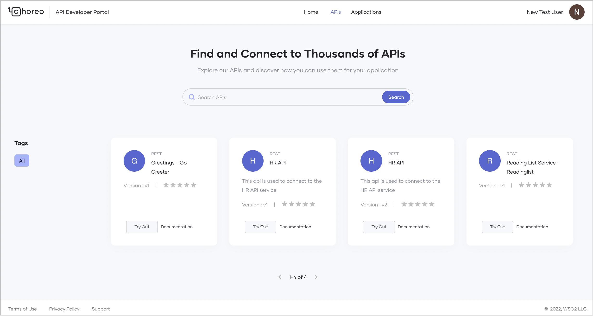
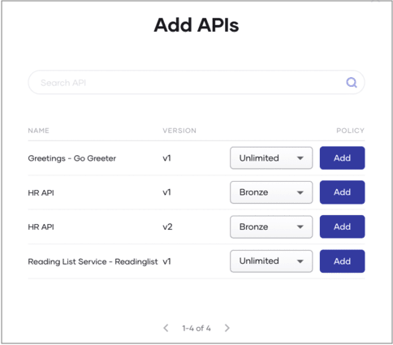

# Consume an OAuth2 Secured Service

WSO2 Developer Platform is a powerful platform that enables developers to create, deploy, and consume services efficiently. The WSO2 Developer Platform Developer Portal simplifies API discovery and usage, allowing developers to integrate APIs seamlessly into their applications.

This guide is intended for application developers (both internal and external) who wish to consume APIs published in the Developer Portal to build their applications. You will learn how to:

- Discover APIs
- Create an application and generate credentials
- Subscribe to an API
- Consume a published REST API via a web application

---

<Prerequisites>

## Prerequisites

Before proceeding, ensure you have access to a published service to consume. If you do not have one, follow the [Develop a Service](../develop-components/develop-services/develop-a-service.mdx) guide to create and deploy a sample REST API.

---

</Prerequisites>

## Discover APIs

In the WSO2 Developer Platform Developer Portal, developers can search for APIs by name. APIs and services created and published through the WSO2 Developer Platform Console are visible in the Developer Portal based on their visibility settings:

- **Public**: Visible to all users in the Developer Portal.
- **Private**: Accessible only to signed-in users.
- **Restricted**: Available to users with specific roles, enabling granular access control.

For more details, refer to [Control API Visibility](../api-management/control-api-visibility.mdx).

### Viewing Available APIs

The Developer Portal lists APIs categorized by their major versions. The API overview page displays:

- Subscribed versions of the API
- Subscription details (e.g., application name and creation date)



### Selecting the Correct API Version

> **Tip:** It is recommended to use the latest version of an API. Copy the **Endpoint(s)** from the API overview page and integrate it into your client application to ensure compatibility with the most recent updates.

---

## Create an application


An application in WSO2 Developer Platform is a logical representation of a physical application, such as a mobile app, web app, or device. To consume an API in WSO2 Developer Platform, you need to create an application that maps to your physical application and subscribe to the required API under a usage policy plan. This plan provides a usage quota. A single application can have multiple API subscriptions. Using the consumer key and consumer secret, you can generate an access token to invoke all APIs subscribed to the same application.

This guide walks you through the steps to create an application in WSO2 Developer Platform.

<Steps>

## Create an application {/* #step-1-create-an-application */}

To create an application in the WSO2 Developer Platform Developer Portal, follow these steps:

1. Go to the [WSO2 Developer Platform Developer Portal](https://devportal.choreo.dev) and sign in.

2. In the Developer Portal header, click **Applications** and then click **+Create**.

3. Enter application details. Provide a name and description for your application.

4. Click **Create**.

This creates the application and opens the **Application Overview** page. Here, you can view details such as the token type, workflow status, and the application owner.

## Generate keys {/* #step-2-generate-keys */}

WSO2 Developer Platform uses OAuth 2.0 bearer token-based authentication for API access. An API access token is a string passed as an HTTP header in API requests to authenticate access.

Once you create an application, you can generate credentials for it. WSO2 Developer Platform provides a consumer key and consumer secret when you generate credentials for the first time. The consumer key acts as the unique identifier for the application and is used for authentication.

### Generate environment-specific keys and tokens

You can generate keys and tokens to invoke production and non-production endpoints separately.

:::info[Note]

Access to production endpoints depends on your role. If you have the necessary permissions, you can generate keys and tokens for production endpoints.

:::

1. In the [WSO2 Developer Platform Developer Portal](https://devportal.choreo.dev) header, click **Applications**.

2. On the **My Applications** page, click on the application for which you want to generate keys and tokens.

3. In the left navigation menu, click the desired environment under **Credentials**. This opens the **Application Keys** pane for that environment.

4. Expand **Advanced configurations** and review the following options:
    - **Grant types**: Select the grant types to use when generating the access token.
    - **Public client**: Enable **Allow authentication without the client secret** if your application is a public client (e.g., a browser or mobile app).
    - **PKCE for enhanced security**: Set to **Mandatory** if you want the application to send a code challenge in the authorization request and a code verifier in the token request. Asgardeo supports SHA-256 and plain.
    - **Application access token expiry time**: Set the access token expiry time in seconds.
    - **Refresh token expiry time**: Set the refresh token expiry time in seconds.
    - **ID token expiry time**: Set the ID token expiry time in seconds.

5. Click **Generate Credentials**. The **Application Keys** pane will display the consumer key and consumer secret.

You can use the consumer key and consumer secret to generate an API access token by invoking the token endpoint. You can also revoke the access token by invoking the revoke endpoint.

To generate a test token for testing purposes, click **Generate Token** and copy the displayed token. Alternatively, click **cURL** to copy the generated cURL command and obtain a test token using a cURL client.

:::warning

Do not use the test token in your production environment.

:::

</Steps>


## Subscribe to an API


To use a published API in your application, you must subscribe to it. When you subscribe to an API, your subscription covers all minor versions within the API's major version.

The subscription process ensures secure authentication of API requests using application keys. While you can generate credentials for an API without subscribing to an application, this approach limits advanced configuration options such as access token expiry time, revoke token expiry time, ID token expiry time, and enabling access to the API without a secret. Generating keys directly in the API is suitable for testing or short-term use but is not recommended for long-term production usage.

To subscribe to an API via an application, follow these steps:

1. Go to the [WSO2 Developer Platform Developer Portal](https://devportal.choreo.dev) and sign in.

2. To navigate to applications, in the Developer Portal header, click **Applications**.

3. On the **My Applications** page, click on the application you want to use to subscribe to an API.

4. In the left navigation menu, click **Subscriptions**.

5. In the **Subscription Management** pane, click **+ Add APIs**.

6. Click **Add** to subscribe to an API. You can subscribe to one or more APIs based on your requirements.

    :::tip

    When a new minor version of an API is published, the major version-based invocation URL automatically routes to the latest minor version within the subscribed API's major version. This ensures that existing client applications continue to function without disruption while benefiting from improvements or additions in the newer minor version.

    :::

    

Once you subscribe to an API, you can invoke it using the application keys.


## Generate an access token via curl

Follow these steps to generate an access token for your application using cURL:

1. In the [WSO2 Developer Platform Developer Portal](https://devportal.choreo.dev) header, click **Applications**.

2. On the **My Applications** page, click on the application for which you want to generate the token.

3. In the left navigation menu, click the desired environment under **Credentials**. This opens the **Application Keys** pane for that environment.

4. Copy the **Consumer key**, **Consumer secret**, and **Token endpoint** values.

5. Use the following template and replace the placeholders with the values you copied:

    <Tabs>
    <TabItem value="tab-0" label="Format">


    </TabItem>
    </Tabs>
    ```bash
    curl -k -X POST <token_endpoint> -d "grant_type=client_credentials" -H "Authorization: Basic <base64encode(consumer-key:consumer-secret)>"
    ```

6. Run the curl command to generate an access token.

## Generate an access token via the Developer Portal UI (for testing)

To generate an access token for **testing purposes**, follow these steps:

1. In the [WSO2 Developer Platform Developer Portal](https://devportal.choreo.dev) header, click **Applications**.

2. On the **My Applications** page, click on the application for which you want to generate keys and tokens.

3. In the left navigation menu, click the desired environment under **Credentials**. This opens the **Application Keys** pane for that environment.

4. Click **Generate Token** to create a test access token.

## Consume an API

Use this generated access token to authenticate API requests by including it in the `Bearer` header when invoking the API.

Example:
    
```bash
curl -H "Authorization: Bearer <YOUR_ACCESS_TOKEN>" -X GET "https://my-sample-api.choreoapis.dev/greet"  
```

:::note

The name of the Authorization header may vary depending on the API provider’s configuration. Always refer to the API’s Swagger (OpenAPI) definition for the correct header format.

:::
