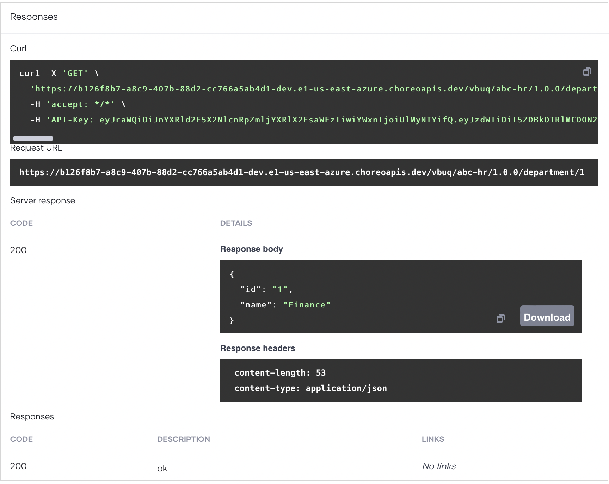
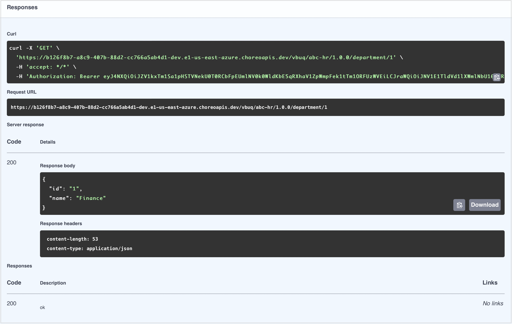

# Develop an API Proxy from Scratch

An API proxy acts as an intermediary between an existing API and WSO2 Developer Platform, intercepting all requests made to the API. It also functions as a managed API, allowing you to apply essential API management features such as security policies and rate limiting.

In this guide, you will:

- Create an API proxy component to expose an existing API.
- Deploy the API proxy.
- Test the API proxy to verify its functionality.
- Manage the API.
- Consume the API.

<Prerequisites>

## Prerequisites

- If you're signing in to the WSO2 Developer Platform Console for the first time, create an organization:
    1. Go to the [WSO2 Developer Platform Console](https://console.choreo.dev/) and sign in using your preferred method.
    2. Enter a unique organization name. For example, `Stark Industries`.
    3. Read and accept the privacy policy and terms of use.
    4. Click **Create**.

    This creates the organization and opens the **Project Home** page of the default project created for you.

</Prerequisites>

<Steps>

## Create an API proxy {/* #step-1-create-an-api-proxy */}

To create an API proxy, you can either upload an OpenAPI specification or provide an OpenAPI specification URL. In this guide, you will specify a URL to an OpenAPI definition of a sample API.

1. Go to the [WSO2 Developer Platform Console](https://console.choreo.dev/) and sign in. This opens the project home page.
2. If you already have one or more components in your project, click **+ Create**. Otherwise, proceed to the next step.
3. Click the **API Proxy** card. This opens the **Create an API Proxy** pane.
4. Select **Creare from Scratch** option.
5. Specify the following values as Proxy Metadata:

    | **Field**       | **Value**                                  |
    |-----------------|--------------------------------------------|
    | **Context**     | `department-service`                                   |
    | **Version**     | `v1.0`                                      |
    | **Target**      | `https://samples.choreoapps.dev/company/hr` |

6. Enter following details for the Component Details:

    :::info

    The **Component Name** field must be unique and cannot be changed after creation.

    :::

    | **Field**                 | **Value**          |
    |---------------------------|--------------------|
    | **Component Display Name**| `Department Service`          |
    | **Component Name**        | `department-service`          |
    | **Description**           | `Sample proxy for department service`     |

7. Click **Create**. This creates the API proxy component and takes you to the **Deploy** page.

## Define resources for the API proxy {/* #step-2-define-resources-for-the-api-proxy */}

To add a new resource that retrieves a department by the department ID, follow these steps:

1. In the left navigation menu, click **Develop** and then click **Resources**.
2. Select **GET** as the **HTTP Verb** and enter `/department/{departmentId}` as the **URI Pattern**.
3. Click **+** to add the resource.
4. Expand the added resource and specify the following values:

    | **Field**        | **Value**                            |
    |------------------|--------------------------------------|
    | **Operation ID** | `findDepartment`                     |
    | **Description**  | `Find a department by department ID` |

5. Remove the five default resources that start with `/*` by clicking the delete icon corresponding to each resource.
6. Click **Save**.

## Deploy the API proxy {/* #step-3-deploy-the-api-proxy */}

1. In the left navigation menu, click **Deploy**.
2. In the **Build Area** card, click **Configure & Deploy**. This opens the **Configure & Deploy** pane.
3. Select **External** as the API access mode and click **Deploy**. The **Development** card indicates the **Deployment Status** as **Active** when the API proxy is successfully deployed.

Now you are ready to test the API proxy.

## Test the API proxy {/* #step-4-test-the-api-proxy */}

WSO2 Developer Platform allows you to test your API proxy using either the [integrated OpenAPI Console](../../testing/test-rest-endpoints-via-the-openapi-console.mdx) or [cURL](../../testing/test-apis-with-curl.mdx). In this guide, you will use the OpenAPI Console.

:::tip

WSO2 Developer Platform enables OAuth 2.0 to secure APIs by default. Therefore, you need an access token to invoke an API.

- WSO2 Developer Platform automatically generates a key to test the API via the OpenAPI Console. To view the key, click the show key icon in the **Security Header** field.
- To disable security for the entire API or a specific resource:
    1. In the left navigation menu, click **Deploy**.
    2. Go to the **Build Area** card and click **Configure & Deploy**.
    3. In the **Configure & Deploy** pane:
        - To disable security for the entire API, clear the **OAuth2** checkbox.
        - To disable security for a specific resource, turn off the **Security** toggle in the relevant resource.
    4. Click **Deploy**.

:::

1. In the left navigation menu, click **Test** and then click **OpenAPI Console**.
2. Select **Development** from the environment drop-down list.
3. Expand the `GET /department/{departmentId}` resource and click **Try it Out**.
4. Enter `1` as the **departmentId** and click **Execute**. You will see a response similar to the following:

    

    This indicates that your API proxy is working as expected.

## Manage the API proxy {/* #step-5-manage-the-api-proxy */}

Now that you have a tested API proxy, you can publish it and make it available for application developers to consume. In this guide, you will apply rate limiting to the API and publish it.

<Steps>

### Apply rate limiting to the API proxy {/* #step-51-apply-rate-limiting-to-the-api-proxy */}

1. In the left navigation menu, click **Deploy**.
2. Go to the required environment card and click the settings icon corresponding to **CORS, Rate Limiting and Resiliency**.
3. In the **CORS, Rate Limiting and Resiliency** pane, click **Rate Limiting** to expand the section.
4. Select **API Level** as the **Rate Limiting Level**.
5. Specify appropriate values for the **Request Limit** and **Time Unit** fields. You can proceed with the default values.
6. Click **Apply**. This applies the rate limiting level to the API proxy and redeploys it.

### Publish the API proxy {/* #step-52-publish-the-api-proxy */}

**Publishing** makes your API available in the **WSO2 Developer Platform Developer Portal (Devportal)**, enabling application developers to access and use it. In WSO2 Developer Platform, the **Production** environment is exposed to the **Devportal**  by default. After completing Step 5.1, the API is only available to the internal developers within your organization for testing purposes. To make the API accessible for external application developers, go to the **Deploy** page and **Promote** the API to the **Production** environment by following the same steps outlined in Step 5.1.

If you need to change the default environments exposed to the Devportal, refer to the [Configure Exposed Environments to Developer Portal](../../administer/configure-exposed-environments-to-developer-portal.md
) documentation.

Once the API is successfully promoted, it will become available in the **Production** environment. You can then proceed with the publishing steps below to make it publicly accessible.

:::note

Organizations created before **April 24th, 2025**, will have the **Development** environment exposed by default. Hence, organizations created before this date does not require to promote API to the **Production** environment.

:::

1. In the left navigation menu, click **Lifecycle** under **Manage**. This takes you to the **Lifecycle** page.
2. Click **Publish**.
3. In the **Publish API** dialog, click **Confirm** to proceed with publishing the API. If you want to change the display name, make the necessary changes and then click **Confirm**. This changes the API lifecycle state to **Published**.

</Steps>

## Invoke the API From DevPortal {/* #step-6-invoke-the-api-from-devportal */}

To generate credentials for the published API and invoke it via the WSO2 Developer Platform Developer Portal, follow these steps:

1. In the **Lifecycle** page, click **Go to Devportal**. This takes you to the `Department Service` in the WSO2 Developer Platform Developer Portal.

2. Invoke the API:
    1. In the Developer Portal left navigation menu, click **Try Out**.
    2. In the **Endpoint** list, select **Development** as the environment to try out the API.
    3. Click **Get Test Key** to generate an access token.
    4. Expand the `GET /department/{departmentId}` resource and click **Try it out**.
    5. Enter `1` as the **departmentId** and click **Execute**. You will see a response similar to the following:

        

Now, you have gained hands-on experience creating, deploying, testing, and publishing an API proxy using WSO2 Developer Platform.

</Steps>
