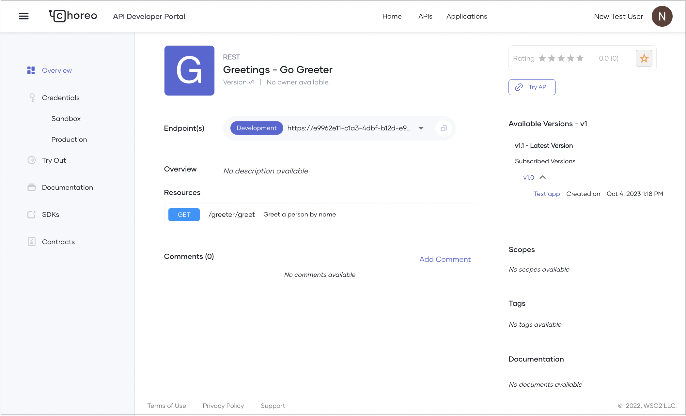

# Consume an OAuth2 Secured Service

WSO2 Developer Platform is a platform that allows you to create, deploy, and consume services seamlessly. The WSO2 Developer Platform Developer Portal simplifies the process of discovering and using APIs for developers. 

This guide is designed for application developers (internal or external to your organization) who want to consume APIs published in the Developer Portal to build their applications. You will learn how to:

- Discover APIs
- Create an application and generate credentials
- Subscribe to an API
- Consume a published REST API via a web application

<Prerequisites>

## Prerequisites

If you don’t already have a published service to consume, follow the [Develop a Service](../develop-components/develop-services/develop-a-service.mdx) documentation to publish and deploy a sample REST API.

</Prerequisites>

## Discover APIs

In the WSO2 Developer Platform Developer Portal, developers can search for APIs by name. APIs and services created and published through the WSO2 Developer Platform Console are visible in the Developer Portal based on their visibility settings:

- **Public**: The API is visible to everyone in the Developer Portal.
- **Private**: The API is visible only to users who sign in to the Developer Portal.
- **Restricted**: The API is visible only to users with specific roles. This allows for fine-grained access control.

To learn more about API visibility, see [Control API Visibility](../api-management/control-api-visibility.mdx).

The Developer Portal lists APIs by their major version.


The API overview page displays subscribed versions of the API along with subscription details such as the application name and creation date.



:::tip

To use an API, it’s recommended to use the latest version. Copy the **Endpoint(s)** value from the API overview page and use it in your client application. This ensures your application always invokes the latest API version.

:::

## Create an application


An application in WSO2 Developer Platform is a logical representation of a physical application, such as a mobile app, web app, or device. To consume an API in WSO2 Developer Platform, you need to create an application that maps to your physical application and subscribe to the required API under a usage policy plan. This plan provides a usage quota. A single application can have multiple API subscriptions. Using the consumer key and consumer secret, you can generate an access token to invoke all APIs subscribed to the same application.

This guide walks you through the steps to create an application in WSO2 Developer Platform.

<Steps>

## Create an application {/* #step-1-create-an-application */}

To create an application in the WSO2 Developer Platform Developer Portal, follow these steps:

1. Go to the [WSO2 Developer Platform Developer Portal](https://devportal.choreo.dev) and sign in.

2. In the Developer Portal header, click **Applications** and then click **+Create**.

3. Enter application details. Provide a name and description for your application.

4. Click **Create**.

This creates the application and opens the **Application Overview** page. Here, you can view details such as the token type, workflow status, and the application owner.

## Generate keys {/* #step-2-generate-keys */}

WSO2 Developer Platform uses OAuth 2.0 bearer token-based authentication for API access. An API access token is a string passed as an HTTP header in API requests to authenticate access.

Once you create an application, you can generate credentials for it. WSO2 Developer Platform provides a consumer key and consumer secret when you generate credentials for the first time. The consumer key acts as the unique identifier for the application and is used for authentication.

### Generate environment-specific keys and tokens

You can generate keys and tokens to invoke production and non-production endpoints separately.

:::info[Note]

Access to production endpoints depends on your role. If you have the necessary permissions, you can generate keys and tokens for production endpoints.

:::

1. In the [WSO2 Developer Platform Developer Portal](https://devportal.choreo.dev) header, click **Applications**.

2. On the **My Applications** page, click on the application for which you want to generate keys and tokens.

3. In the left navigation menu, click the desired environment under **Credentials**. This opens the **Application Keys** pane for that environment.

4. Expand **Advanced configurations** and review the following options:
    - **Grant types**: Select the grant types to use when generating the access token.
    - **Public client**: Enable **Allow authentication without the client secret** if your application is a public client (e.g., a browser or mobile app).
    - **PKCE for enhanced security**: Set to **Mandatory** if you want the application to send a code challenge in the authorization request and a code verifier in the token request. Asgardeo supports SHA-256 and plain.
    - **Application access token expiry time**: Set the access token expiry time in seconds.
    - **Refresh token expiry time**: Set the refresh token expiry time in seconds.
    - **ID token expiry time**: Set the ID token expiry time in seconds.

5. Click **Generate Credentials**. The **Application Keys** pane will display the consumer key and consumer secret.

You can use the consumer key and consumer secret to generate an API access token by invoking the token endpoint. You can also revoke the access token by invoking the revoke endpoint.

To generate a test token for testing purposes, click **Generate Token** and copy the displayed token. Alternatively, click **cURL** to copy the generated cURL command and obtain a test token using a cURL client.

:::warning

Do not use the test token in your production environment.

:::

</Steps>


## Subscribe to an API


To use a published API in your application, you must subscribe to it. When you subscribe to an API, your subscription covers all minor versions within the API's major version.

The subscription process ensures secure authentication of API requests using application keys. While you can generate credentials for an API without subscribing to an application, this approach limits advanced configuration options such as access token expiry time, revoke token expiry time, ID token expiry time, and enabling access to the API without a secret. Generating keys directly in the API is suitable for testing or short-term use but is not recommended for long-term production usage.

To subscribe to an API via an application, follow these steps:

1. Go to the [WSO2 Developer Platform Developer Portal](https://devportal.choreo.dev) and sign in.

2. To navigate to applications, in the Developer Portal header, click **Applications**.

3. On the **My Applications** page, click on the application you want to use to subscribe to an API.

4. In the left navigation menu, click **Subscriptions**.

5. In the **Subscription Management** pane, click **+ Add APIs**.

6. Click **Add** to subscribe to an API. You can subscribe to one or more APIs based on your requirements.

    :::tip

    When a new minor version of an API is published, the major version-based invocation URL automatically routes to the latest minor version within the subscribed API's major version. This ensures that existing client applications continue to function without disruption while benefiting from improvements or additions in the newer minor version.

    :::

    

Once you subscribe to an API, you can invoke it using the application keys.


## Consume the API via your web application

To securely invoke the API/service, you need to use your Identity Provider (IdP). Follow these steps:

1. Create a web application in WSO2 Developer Platform.
2. Create an OAuth application in the IdP.
3. Configure the web application to authenticate API/service invocations using the IdP.
4. Deploy the web application.

For this guide, you’ll use:
- **WSO2 Asgardeo** as the IdP.
- **[WSO2 Developer Platform-samples/reading-list-app/reading-list-front-end](https://github.com/wso2/choreo-samples/tree/main/reading-list-app/reading-list-front-end)** as the web application. This is a React SPA that uses Axios to invoke the service. It is configured to work with the **[WSO2 Developer Platform-samples/reading-list-app/reading-list-service](https://github.com/wso2/choreo-samples/tree/main/reading-list-app/reading-list-service)**. You can modify this web application to work with your service or deploy the sample service in WSO2 Developer Platform.

<Steps>

### Create a web application component {/* #step-1-create-a-web-application-component */}

:::info

You can use your own web application instead of the sample. For this guide, you’ll use the [WSO2 Developer Platform-samples/reading-list-app/reading-list-front-end](https://github.com/wso2/choreo-samples/tree/main/reading-list-app/reading-list-front-end).

:::

To host the front-end application in WSO2 Developer Platform, create a web application component:

1. In the WSO2 Developer Platform Console, select the project for the reading list application from the project list in the header.
2. Click **Create** under the **Component Listing** section.
3. On the **Web Application** card, click **Create**.
4. Enter the following details:

    | **Field**       | **Value**               |
    |-----------------|-------------------------|
    | **Name**        | `Reading List Web App`  |
    | **Description** | `Frontend application for the reading list service` |

5. Click **Next**.
6. Click **Authorize with GitHub** to connect WSO2 Developer Platform to your GitHub account.
7. In the **Connect Repository** pane, enter the following:

    | **Field**             | **Value**                               |
    |-----------------------|-----------------------------------------|
    | **GitHub Account**    | Your account                            |
    | **GitHub Repository** | **`WSO2 Developer Platform-samples`**                    |
    | **Branch**            | **`main`**                              |
    | **Build preset**         | **React** (since it’s a React app built with Vite) |
    | **Build Context Path**| **`reading-list-app/reading-list-front-end`** |
    | **Build Command**     | **`npm install && npm run build`**      |
    | **Build Output**      | **`dist`**                              |
    | **Node Version**      | **`18`**                                |

8. Click **Create**. This initializes the service with the GitHub repository and takes you to the **Overview** page.

### Create an OAuth application in the IdP {/* #step-2-create-an-oauth-application-in-the-idp */}

To invoke the API/service, you need an access token. Create an OAuth application in the IdP (for example, Asgardeo) with the following settings:

- **Allowed grant types**: Code
- **Public client**: Enable this option.
- **Authorized redirect URLs**: Add the web app URL.
- **Allowed origins**: Add the same URLs as authorized redirect URLs.
- **Access Token**: Set to JWT.

WSO2 Developer Platform uses Asgardeo as the default IdP. When you create an application in the WSO2 Developer Platform Developer Portal, it automatically creates a corresponding application in Asgardeo. Follow these steps to configure the Asgardeo OAuth application:

1. Sign in to [Asgardeo](https://console.asgardeo.io/) using the same credentials as WSO2 Developer Platform.
2. Ensure you’re in the same organization used in the WSO2 Developer Platform Developer Portal.
3. In the Asgardeo Console, click **Applications** in the left navigation. You’ll see the **readingListApp** created by WSO2 Developer Platform.
4. Click the edit icon to edit the application.
5. Go to the **Protocol** tab and make the following changes:
    1. Under **Allowed grant types**, select **Code**.
    2. Select the **Public client** checkbox.
    3. In **Authorized redirect URLs**, enter the web app URL and click **+** to add it.
    4. In **Allowed origins**, add the same URLs.
    5. Under **Access Token**, select **JWT** as the token type.
    6. Click **Update**.

### Configure the web application to connect to the IdP and invoke the service {/* #step-3-configure-the-web-application-to-connect-to-the-idp-and-invoke-the-service */}

Update the web app configurations to invoke the **Reading List Service** REST API. These configurations are environment-specific. For this guide, we’ll configure the development environment.

:::note

The web app reads environment-specific configurations from the `window` object at runtime via the `config.js` file. You’ll mount this file for the development environment. Repeat this process for other environments as needed.

:::

To configure the front-end application:

1. On the WSO2 Developer Platform Console header, select the project and the created web application component.
2. In the left navigation menu, click **Deploy**.
3. On the **Deploy** page, under the **Set Up** card and click **Configure & Deploy**.
4. Copy the following JSON configuration, paste it into the text area in the **File Mount pane**, and replace the placeholders with the values from the previous steps:


    ```javascript
    window.config = {
        redirectUrl: "<web-app-url>",
        asgardeoClientId: "<asgardeo-client-id>",
        asgardeoBaseUrl: "https://api.asgardeo.io/t/<your-org-name>",
        choreoApiUrl: "<reading-list-service-url>"
    };
    ```


    | **Field**             | **Description**                               |
    |-----------------------|-----------------------------------------------|
    | **redirectUrl**       | The web app URL you copied earlier.           |
    | **asgardeoClientId**  | The **Client ID** from the Asgardeo application. |
    | **asgardeoBaseUrl**   | The IdP API URL with your organization name (e.g., `https://api.asgardeo.io/t/<ORG_NAME>`). |
    | **choreoApiUrl**      | The **Reading List Service** URL from the endpoint table in the overview page. |
        
    :::tip

    You can refer to the mounted configuration file as `./config.js` within your web application.

    :::
    
5. Click **Deploy**.
6. Once deployed, copy the **Web App URL** from the development environment card.
7. Navigate to the web app URL to verify it’s successfully hosted.


That’s it! You can now use a user from your IdP to sign in and invoke the service through your web application.

</Steps>
