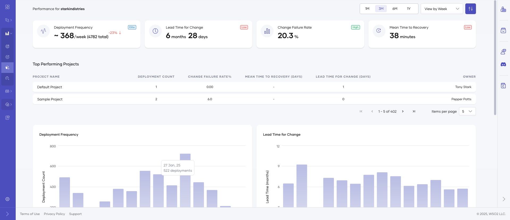
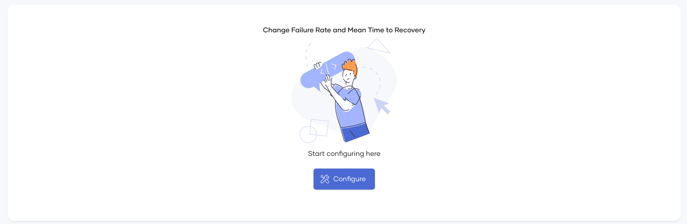
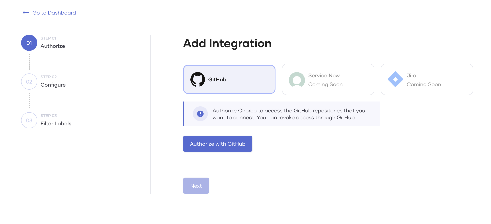
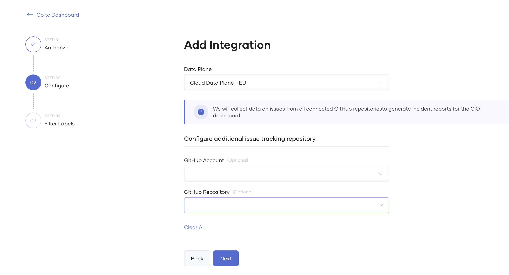
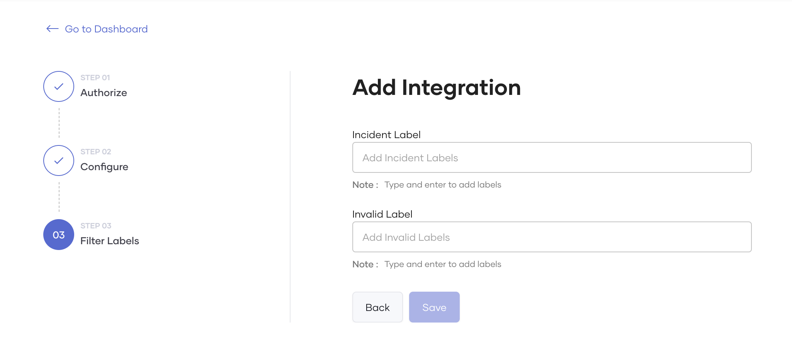
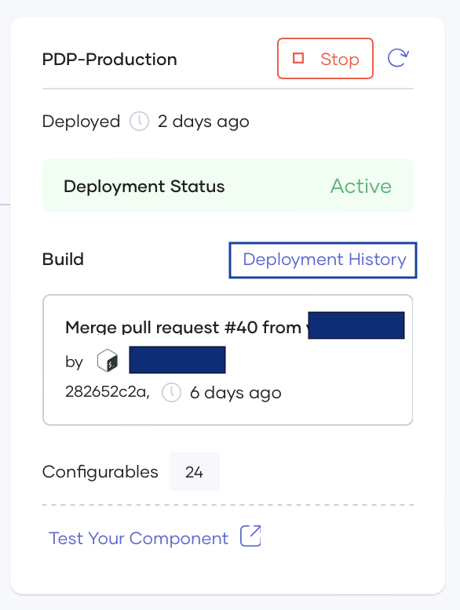
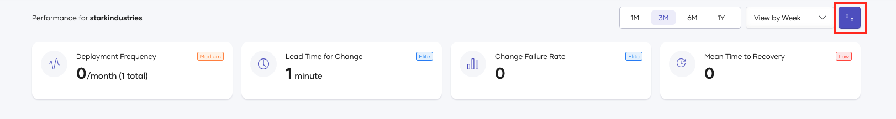

# Delivery Insights

You can view delivery insights in WSO2 Developer Platform to use as Key Performer Indicators (KPIs) to measure your organization's DevOps team's performance. WSO2 Developer Platform enables this feature by default for all organizations. Delivery insights includes the following four key metrics (DORA metrics) that are regarded as the most important metrics to indicate team performance:

- Deployment Frequency: How often an organization successfully releases to production
- Lead Time for Changes: The amount of time it takes a commit to get into production
- Change Failure Rate: The percentage of deployments causing a failure in production
- Mean Time to Recovery: How long it takes an organization to recover from a failure in production

WSO2 Developer Platform enables two insights by default; deployment frequency and lead time for change.

## Configure the Delivery Insights dashboard with all metrics

To configure the dashboard by enabling the other two metrics, follow the steps below:

1. Sign in to [WSO2 Developer Platform](https://console.choreo.dev/).
2. In the WSO2 Developer Platform Console, go to the top navigation menu and click **Organization**. Then select your organization. 
3. On the left navigation menu, click **Insights** and then click on **Delivery**.
4. Scroll to the bottom of the dashboard and click **Configure**.
5. Select your incident management system. Currently, WSO2 Developer Platform only supports GitHub. 

## Configuring GitHub as the incident management system

To configure GitHub as the incident management system, follow the steps below: 

<Steps>

### Authorize {/* #step-1-authorize */}

First, let's authorize WSO2 Developer Platform to access the repositories used to record incidents. 

On the **Add Integration** page,  select **GitHub** and click **Authorize with GitHub**.

Once the authorization process is complete, you can start configuring the GitHub repository.

### Configure {/* #step-2-configure */}

By default, WSO2 Developer Platform collects incident details(issues) from all repositories containing WSO2 Developer Platform components. However, you can configure a GitHub account and a GitHub repository to allow WSO2 Developer Platform to read issues from a specific repository, and then click **Next**. 

| **Field**       | **Description**                   |   **Value**   |
|-----------------|-----------------------------|-----------------------------|
| **Data Plane**  | WSO2 Developer Platform collects incident details by running a scheduled job which invokes the GitHub API periodically. This job runs on the user's data plane.   This configuration allows users to specify a preferred data plane to run the job, especially when they have multiple data planes. | Select a preferred data plane from the **Data Plane** list.        |
| **GitHub Account** | The GitHub account you have your repositories in.  | Select your GitHub account that includes the repository used for incident collection.|
| **GitHub Repository**| By default, WSO2 Developer Platform will collect incident details(issues) from all repositories that already have WSO2 Developer Platform components. |
    

### Filter label {/* #step-3-filter-label */}

The filter label allows WSO2 Developer Platform to scrape issues associated with that label.

- **Incident Label**:  The label WSO2 Developer Platform uses to identify incidents. For example, `Type/Incident`. 

- **Invalid incident label**(Optional): WSO2 Developer Platform will not scrape issues with this label and will proceed to skip these issues. For example, `Resolution/Invalid`. You can use this label when you want to ignore issues. For example, closing an issue after identifying that it doesn't qualify as an incident issue as it was due to a user error. 

Once you configure the labels, click **Save**.

WSO2 Developer Platform will enable incident data publishing in the background once you save. Once completed, the metric charts will appear in the delivery insights dashboard for **Mean Time To Recover** and **Change Failure Rate**. If there are any issues in the configuration, the configure banner will reappear, and the user can proceed to reconfigure.

### Enrich incident tickets with deployment information {/* #step-4-enrich-incident-tickets-with-deployment-information */}

WSO2 Developer Platform extracts deployment information from the relevant incident and generates DORA metrics that help you analyze the deployment statistics related to the incidents. Therefore, you must manually update the GitHub issue with the relevant deployment-related information. Follow the steps below to add the deployment information to the GitHub issue. 
 
#### Get deployment details

1. In the WSO2 Developer Platform Console top navigation menu, select the **Organization**, then the **Project** and finally the relevant **Component** for which the incident was reported.
2. On the left navigation menu, click **DevOps** and then click on **CD Pipelines**
3. On the **Production Environment** card, click **Deployment History**.
4. On the right-hand side panel, select the relevant deployment, and click **Release details** to copy the deployment details to the clipboard. 

    

#### Add deployment information to the GitHub issue

1. Edit the GitHub issue to add the deployment information. 
2. Paste the deployment information you copied (in step 4 under the section `Get deployment details`) at the end of the issue body.
3. Click **Save**.

That's it! You have successfully configured your delivery insights dashboard to include all DORA metrics. 

:::note

The delivery insights dashboard is expected to reflect the latest statistics within approximately 30 minutes.

:::

</Steps>

## Edit configurations

   

   You can edit or override the configurations you made via the edit option in the dashboard.
